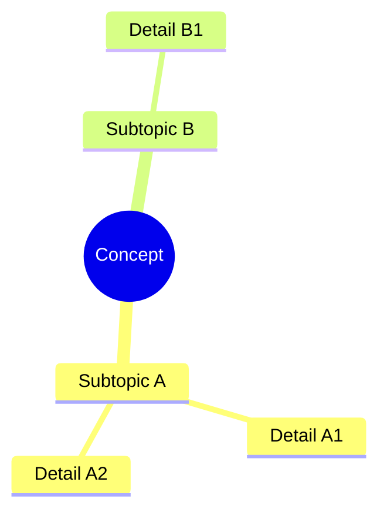

# 03. Concept Specification Framework

Every conceptual note in the 3D-SynTree vault follows this strict schema. This ensures consistency, completeness, and navigability across all ten modules.

## Note Schema

```markdown
# [Concept Name]

### 1. What It Is
[Formal scientific definition written from absolute zero. No prior knowledge assumed.]

### 2. Why It Exists
[The fundamental physical, chemical, mathematical, or computational problem this concept addresses.]

### 3. How It Works
[Mechanisms, mathematical derivations, chemical rules, or algorithms governing the concept. Include equations where relevant.]

### 4. What It Consists Of
[Component parts, specialized sub-vocabulary, variables, equations, and structural elements.]

### 5. What You Must Understand
[Non-negotiable conceptual knowledge, common pitfalls, and points students frequently miss.]

### 6. Prerequisites
[Explicit [[WikiLinks]] to foundational notes that must be mastered first. Use the exact note titles.]

### 7. Project Connection
[Direct, concrete mapping to the 3D-SynTree codebase, file, tensor, function, or architecture component. Cite specific functions, classes, and file paths.]

### 8. Required Depth
[Essential | Supporting | Advanced]

### 9. Further Dependencies
[Concepts in subsequent modules that depend directly on this note, as [[WikiLinks]].]
```

## Depth Classification

| Depth | Meaning | Study Expectation |
|-------|---------|-------------------|
| **Essential** | Absolutely necessary to understand the project | Master completely; able to explain without notes |
| **Supporting** | Important for understanding specific components in depth | Understand the mechanism; able to trace to code |
| **Advanced** | Necessary for research-level analysis, critical evaluation, extensions | Familiar with the concept; aware of its role and limitations |

## Wikilink Convention

All internal links use Obsidian wikilinks with the exact note title (without the `.md` extension):

- Correct: `[[01_01_Atomic_Structure_and_Electrons]]`
- Correct: `[[07_04_PaiNN_Polarizable_Interaction_Networks]]`
- Incorrect: `[link text](./01_01_Atomic_Structure_and_Electrons.md)`
- Incorrect: `[[01_01_Atomic_Structure_and_Electrons.md]]`

## File Naming Convention

All files use **numbering followed by a period and a space**, with **no underscores**:

- Correct: `01. Atomic Structure and Electrons.md`
- Correct: `02. The 32 Certified Reaction Grammar.md`
- Incorrect: `01_Atomic_Structure_and_Electrons.md`
- Incorrect: `01.Atomic Structure.md` (missing space after period)

## Example: Fully Populated Note

Below is a template showing a fully populated note following the schema:

```markdown
# Example Concept Name

### 1. What It Is
A formal definition starting from absolute zero, assuming no prior knowledge of the domain.

### 2. Why It Exists
The problem this concept solves in chemistry, biology, mathematics, or machine learning.

### 3. How It Works
Detailed mechanism with equations, chemical rules, or algorithmic steps.

### 4. What It Consists Of
Component parts, variables, terminology, and structural elements.

### 5. What You Must Understand
Key insights, common misconceptions, and pitfalls to avoid.

### 6. Prerequisites
[[01_01_Atomic_Structure_and_Electrons]]
[[02_02_The_Certified_Reaction_Grammar]]

### 7. Project Connection
`syntree/chemistry/reactions.py` — `REACTION_TEMPLATES` dictionary defines the reaction grammar.

### 8. Required Depth
Essential

### 9. Further Dependencies
[[03_02_Rotatable_Bonds_and_Dihedral_Angles]]
[[09_01_The_Assembly_MDP_Formulation]]
```

## Tags Used in This Vault

- `#essential` — Notes classified as Essential depth
- `#supporting` — Notes classified as Supporting depth
- `#advanced` — Notes classified as Advanced depth
- `#chemistry/foundations` — Module 01 notes
- `#medicinal-chemistry` — Module 02 notes
- `#spatial-chemistry` — Module 03 notes
- `#structural-biology` — Module 04 notes
- `#pharmacology` — Module 05 notes
- `#cheminformatics` — Module 06 notes
- `#geometric-deep-learning` — Module 07 notes
- `#circular-statistics` — Module 08 notes
- `#gflownet` — Module 09 notes
- `#benchmarking` — Module 10 notes

## Mermaid Diagram Standard

All diagrams in this vault use **Mermaid mind map syntax only**. ASCII art, flowcharts with box-drawing characters (`/`, `|`, `_`, `-`, `+`), and other text-based diagrams are strictly prohibited. Mermaid mind maps are used because they:

- Render cleanly in Obsidian
- Visualize hierarchical knowledge relationships
- Support recursive expansion of subtopics
- Do not use character-based drawing styles

Example Mermaid mind map:



---

**Next:** Begin with [[01_01_Atomic_Structure_and_Electrons]] — the entry point with no prerequisites.